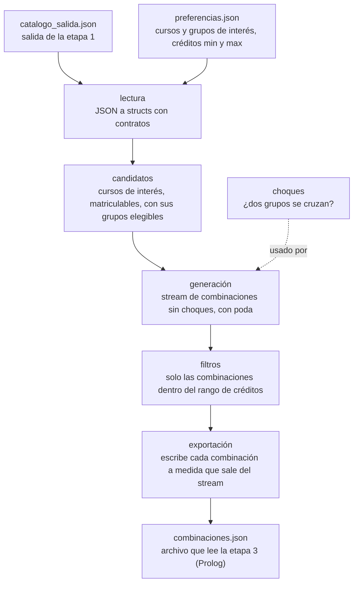

# CEmestre — Etapa 2 (Paradigma Funcional, Racket)

Parte 2 de 4 del proyecto [CEmestre](../README.md). Lee lo que produjo
[`etapa1-c/`](../etapa1-c/) y escribe lo que va a leer `etapa3-prolog/`.

Integrantes: Jose, Pablo, Javier y Sebastián.

Programa en Racket que toma el catálogo validado por la etapa 1 (6 semestres de
Ingeniería en Computadores y de Ingeniería en Producción Industrial) y un
archivo de preferencias del estudiante. Con ellos **genera con streams** las
combinaciones de horario válidas (un grupo por cada curso incluido, sin choques
entre los grupos elegidos), **descarta una combinación apenas detecta un
choque**, las **filtra por el rango de créditos** pedido y las **exporta a un
archivo JSON** para la siguiente etapa (Prolog).

No arma el horario final, no sugiere ni optimiza, y no tiene interfaz: el
resultado es únicamente un archivo.

## 2.1 Arquitectura del proyecto

### Flujo del programa

Es un programa independiente que lee dos archivos JSON y escribe uno. Entre la
lectura y la escritura, las combinaciones viajan como un **stream**: cada paso
consume el stream del anterior y entrega otro, sin construir nunca la lista
completa. `main.rkt` encadena los módulos:

```racket
(define (ejecutar ruta-catalogo ruta-preferencias ruta-salida)
  (let* ([cat (leer-catalogo ruta-catalogo)]
         [prefs (leer-preferencias ruta-preferencias)]
         [opciones (construir-opciones cat prefs)]
         [combinaciones (generar-combinaciones opciones)]
         [validas (filtrar-por-creditos prefs combinaciones)])
    (exportar-combinaciones validas ruta-salida)))
```



### Estructura de archivos

```
.
├── main.rkt                  # punto de entrada: encadena los módulos
├── src/
│   ├── tipos.rkt             # structs inmutables y sus contratos
│   ├── lectura.rkt           # JSON -> structs
│   ├── candidatos.rkt        # catálogo + preferencias -> opciones
│   ├── choques.rkt           # ¿chocan dos grupos?
│   ├── generacion.rkt       # opciones -> stream de combinaciones, con poda
│   ├── filtros.rkt           # filtros genéricos y filtro de créditos
│   └── exportacion.rkt       # stream de combinaciones -> JSON
├── tests/                    # una suite rackunit por módulo (56 pruebas)
├── data/
│   ├── catalogo_salida.json  # entrada: salida de la etapa 1
│   ├── preferencias.json     # entrada: preferencias del estudiante
│   └── data_doc.md           # esquema de los archivos de entrada y salida
└── Makefile
```

### Entradas y salida

| Archivo | Contenido |
|---|---|
| `data/catalogo_salida.json` | **Entrada.** Salida de la etapa 1 con 66 cursos de los primeros 6 semestres de las dos carreras (24 solo de Computadores, 27 solo de Producción Industrial y 15 compartidos), con 262 grupos y 366 bloques horarios. De cada curso se usan `codigo`, `creditos`, `carreras`, `grupos` y `matriculable`. El campo `carreras` es la carrera por curso: una sola, o las dos si el curso es compartido. |
| `data/preferencias.json` | **Entrada.** Lista de cursos de interés, cada uno con **más de un grupo** de interés, y los créditos mínimo y máximo deseados. El ejemplo del repositorio tiene 5 cursos y pide entre 9 y 12 créditos. |
| `data/combinaciones.json` | **Salida.** Una entrada por combinación, con los pares curso-grupo, los créditos totales y la carrera de cada curso. Es el contrato con la etapa 3 (formato en 2.2.3). |

El esquema detallado de los tres archivos está en [`data/data_doc.md`](data/data_doc.md).

### Módulos

| Módulo | Funciones públicas | Qué hace |
|---|---|---|
| `tipos.rkt` | los structs de la sección 2.3, `dia/c`, `hora/c` | Define los datos del programa y sus contratos. |
| `lectura.rkt` | `leer-catalogo`, `leer-preferencias`, `jsexpr->curso` y las demás `jsexpr->...` | Convierte los JSON en structs. Es el único módulo que trabaja con JSON crudo. |
| `candidatos.rkt` | `construir-opciones`, `buscar-curso`, `grupos-elegibles` | Deja solo los cursos de interés que son candidatos válidos, con los grupos entre los que se puede elegir. |
| `choques.rkt` | `bloques-se-solapan?`, `grupos-chocan?`, `compatible-con-seleccion?` | Decide si dos grupos se cruzan. |
| `generacion.rkt` | `generar-combinaciones`, `armar-combinacion` | Genera el stream de combinaciones sin choques, con poda. |
| `filtros.rkt` | `filtrar-flujo`, `por-rango`, `filtrar-por-creditos` | Filtra un stream por un criterio y, en concreto, por rango de créditos. |
| `exportacion.rkt` | `combinacion->jsexpr`, `exportar-combinaciones` | Escribe las combinaciones en el JSON de salida. |

**Lectura.** `leer-catalogo` y `leer-preferencias` leen el archivo con
`read-json` y lo convierten con funciones `jsexpr->...` que construyen cada
struct. El día de un bloque pasa de string (`"M"`) a símbolo (`'M`) y se rechaza
cualquier valor que no sea `L K M J V S`. Si falta un campo obligatorio, o el
archivo no existe, está vacío o no es JSON válido, el error dice qué pasó y
`main.rkt` lo muestra sin traza larga.

**Candidatos.** Un curso de interés entra solo si existe en el catálogo, es
`matriculable` (la etapa 1 ya validó sus requisitos y correquisitos) y le queda
al menos un grupo de los que el estudiante pidió. Cada candidato se guarda como
una `opcion`: el curso y sus grupos elegibles, en el orden de la lista de
interés.

**Choques.** Dos bloques chocan si son del mismo día y sus intervalos se cruzan
(`inicio-a < fin-b` y `inicio-b < fin-a`). Un bloque que termina a las 9:20 y
otro que empieza a las 9:20 no chocan. Dos grupos chocan si algún bloque de uno
choca con algún bloque del otro. `compatible-con-seleccion?` revisa un grupo
contra todos los ya elegidos.

**Generación.** Recorre en profundidad un árbol de decisiones. En cada nivel se
decide sobre un curso: no tomarlo, o tomarlo con alguno de sus grupos. Con un
mini-catálogo de tres cursos A, B y C donde A1 choca con B1 (el de
`tests/ejemplos.rkt`):

```
                     (inicio)
         ___________/   |   \___________
     sin A            A1               A2
    /  |  \        /  |   \         /  |  \
 sinB  B1  B2   sinB B1(X) B2    sinB  B1  B2
```

Cada hoja con al menos un curso elegido es una combinación. En `(X)`, A1 y B1
chocan, así que esa rama se corta ahí: nunca se construyen A1+B1 ni A1+B1+C. El
estado de la búsqueda (lo elegido hasta el momento) viaja como argumentos de la
recursión, no se modifica nada: cada rama recibe su propia lista construida con
`cons`.

**Filtros.** `filtrar-flujo` se queda con los elementos de un stream que
cumplen un predicado, sin evaluar el resto por adelantado. `por-rango` arma un
predicado que acepta un valor dentro de `[mínimo, máximo]` con los extremos
incluidos. `filtrar-por-creditos` las compone: filtra las combinaciones por su
total de créditos.

**Exportación.** Escribe el JSON a medida que el stream produce cada
combinación, sin pasarlo a lista. Si el stream está vacío, el archivo sigue
siendo JSON válido (`{"combinaciones": []}`).

### Cómo ejecutar

Requiere [Racket](https://racket-lang.org) con `racket` y `raco` en el PATH, y
`make` (en Windows, desde Git Bash).

```bash
make          # compila
make run      # ejecuta con los archivos de data/
make test     # corre las 56 pruebas
make exe      # genera bin/cemestre-racket, el ejecutable
```

También se pueden indicar los archivos:

```bash
racket main.rkt data/catalogo_salida.json data/preferencias.json data/combinaciones.json
```

Con los datos del repositorio, el programa exporta **60 combinaciones**.

## 2.2 Decisiones de diseño

### 2.2.1 Justificación de decisiones propias y específicas

1. **Contratos en lugar de Typed Racket.** El enunciado acepta "Typed Racket o
   contratos". Elegimos contratos porque Typed Racket no trae tipos para
   `racket/stream` ni para el macro `stream-cons`, y el enunciado exige generar
   con streams. Cada struct se exporta con `contract-out`, así que construirlo
   con un campo del tipo equivocado falla con un error de contrato. Las
   funciones públicas llevan su contrato de entrada y de salida, y los streams
   se tipan con `stream/c`. Los créditos son `exact-nonnegative-integer?` (hay cursos de
   0 créditos, como `SE1400`) y las horas `(integer-in 0 2359)`.

2. **Una combinación es un subconjunto de los cursos candidatos.** El enunciado
   dice "un grupo por cada curso habilitado". Lo interpretamos como un
   subconjunto no vacío de los cursos de interés, con un único grupo por cada
   curso incluido. Si cada combinación llevara todos los cursos, todas sumarían
   los mismos créditos y filtrar por rango de créditos no tendría sentido.

3. **Pereza real con `anexar-perezoso` en vez de `stream-append`.** Cada
   elemento se entrega con `stream-cons`, cuyo resto no se evalúa hasta que se
   pide. La segunda rama de cada decisión viaja como *thunk* y solo se llama
   cuando la primera se agotó. No usamos `stream-append` porque es una función:
   Racket evaluaría las dos ramas antes de llamarla y se perdería la pereza.
   Pedir la primera combinación recorre un solo camino del árbol. La prueba de
   pereza usa 20 cursos de 3 grupos (unas 4²⁰ ≈ 10¹² combinaciones) y toma 50
   al instante.

4. **La poda está en el paso de elegir el grupo.** Antes de bajar a la rama
   "tomar este curso con el grupo g", `tomar-con-cada-grupo` revisa
   `(compatible-con-seleccion? g grupos-elegidos)`. Si g choca con algo ya
   elegido, se salta esa rama completa. Así no se genera una combinación entera
   para descartarla después, que es lo que pide el criterio de grupos de 4.
   Con los datos de ejemplo hay 431 combinaciones posibles de grupos, pero solo
   176 no tienen choques, y esas son las únicas que se construyen.

5. **Polimorfismo con funciones genéricas y un contrato paramétrico.**
   `filtrar-flujo` no sabe qué contiene el stream: sirve para números, textos y
   combinaciones, con cualquier predicado (las pruebas lo usan con los tres
   tipos y con un stream infinito). `por-rango` recibe un extractor que saca un
   número de un elemento de tipo `A` y devuelve un predicado para elementos de
   ese mismo tipo, y su contrato es `(parametric->/c [A] ...)`, que obliga a no
   inspeccionar el valor de tipo `A`. `filtrar-por-creditos`, la única función
   propia del dominio, se arma componiendo ambas.

6. **Los choques se recalculan por grupo en Racket.** Ver el caso límite en
   2.2.2.

7. **`seleccion` guarda el `curso` y el `grupo` completos**, no solo
   `(código . número)`. Así la poda puede revisar los bloques de los grupos ya
   elegidos y la exportación puede escribir créditos, carreras y bloques sin
   volver a buscar en el catálogo.

8. **La carrera por curso es el campo `carreras` de la etapa 1.** El enunciado
   pide la carrera de origen de cada curso. La salida de C ya trae `carreras`
   (una carrera, o las dos en los cursos compartidos como `MA2105`), así que se
   usa tal cual, sin cambiar el código de C, y se exporta en cada selección.

9. **Solo se leen los campos que se usan.** `lectura.rkt` toma `codigo`,
   `creditos`, `carreras`, `grupos` y `matriculable`, e ignora el resto del
   catálogo. Hay menos código de lectura y menos structs que mantener.

10. **Lo que no se puede usar se ignora.** Un curso de interés que no existe en
    el catálogo, que no es matriculable o que no tiene grupos de los pedidos
    simplemente no entra a las combinaciones. Los grupos de un mismo curso con
    horario idéntico se conservan, porque para el estudiante son grupos
    distintos (otro profesor).

11. **El rango de créditos se aplica después, no durante la generación.** La
    poda que pide el enunciado es por choques. El rango es un filtro aparte
    sobre el stream, y así `filtros.rkt` queda reutilizable.

12. **Sin mutación.** El código no usa `set!`, estructuras mutables ni variables
    globales reasignadas (todos los structs son inmutables). Los acumuladores
    se pasan como argumentos de la recursión y `exportar-combinaciones` usa
    `for/fold` con un indicador de "primera combinación" para poner las comas
    entre elementos.

### 2.2.2 Caso límite real

**El `choca_con_otro` de la etapa 1 no sirve para decidir qué grupos pueden ir
juntos.** El enunciado dice que la etapa de C calcula los choques "a nivel de
grupo". Nuestro módulo de C los calcula a nivel de **curso**: marca un curso
con `choca_con_otro = true` si *algún* grupo suyo choca con *algún* grupo de otro
curso. Con 5 grupos por curso eso casi siempre ocurre: en el catálogo real de 66
cursos, **los 66 tienen `choca_con_otro = true`**, así que el campo no distingue
nada.

Un ejemplo real con las preferencias del repositorio: `CE1106` grupo 2,
`QU1107` grupo 1 y `FI2103` grupo 1 se dictan los tres miércoles y viernes de
9:30 a 11:20, así que chocan entre sí. Pero `CE1106` grupo 1 (martes y jueves de
17:00 a 18:50) no choca con `QU1107` grupo 1 ni con `FI2103` grupo 1. El
campo de C marca a los tres cursos igual, y no dice cuál grupo se puede
combinar con cuál.

**Cómo lo resolvimos.** El enunciado pide no modificar la lógica de choques de
C, así que ignoramos ese campo y `choques.rkt` compara bloque contra bloque los
grupos concretos, con las mismas reglas de la etapa 1 (mismo día, intervalo
semiabierto `[inicio, fin)`). Entre los 5 cursos de interés del ejemplo hay 10
pares de grupos que chocan, y la poda los descarta sin construirlos.

### 2.2.3 Justificación del formato de salida

El formato es **JSON**: un solo documento con un arreglo `combinaciones`, un
objeto por combinación.

**Decisión de diseño a la que está ligado.** La exportación es incremental: se
escribe cada combinación apenas el stream la produce, sin convertirlo a lista.
Un arreglo JSON permite hacerlo directamente: se escribe `{"combinaciones": [`,
luego un objeto por combinación separado por comas, y al final `]}`. Cada
combinación es un objeto independiente, así que no hace falta conocer el total
antes de empezar a escribir ni mantener nada en memoria. Si no hay resultados,
queda `{"combinaciones": []}`, que sigue siendo válido. JSON además conserva los
nombres de los campos y la estructura anidada (combinación, selecciones,
bloques) igual que el catálogo de entrada, y Prolog lo puede leer con
`library(http/json)` sin escribir un lector propio.

Ejemplo (fragmento de la salida real; los campos salen en orden alfabético):

```json
{
  "combinaciones": [
  {
    "creditos_totales": 9,
    "selecciones": [
      {
        "bloques": [ { "dia": "M", "hora_fin": 1120, "hora_inicio": 730 } ],
        "carreras": [ "Ingeniería en Producción Industrial" ],
        "creditos": 3,
        "curso": "MI2101",
        "grupo": 1
      },
      {
        "bloques": [ { "dia": "M", "hora_fin": 1450, "hora_inicio": 1300 },
                     { "dia": "V", "hora_fin": 1450, "hora_inicio": 1300 } ],
        "carreras": [ "Ingeniería en Producción Industrial" ],
        "creditos": 3,
        "curso": "QU1107",
        "grupo": 2
      },
      {
        "bloques": [ { "dia": "M", "hora_fin": 1650, "hora_inicio": 1500 },
                     { "dia": "V", "hora_fin": 1650, "hora_inicio": 1500 } ],
        "carreras": [ "Ingeniería en Producción Industrial" ],
        "creditos": 3,
        "curso": "FI2103",
        "grupo": 2
      }
    ]
  }
  ]
}
```

(En el archivo real los arreglos y objetos pequeños se escriben en varias
líneas; aquí se compactaron para que se lea mejor.)

**Campos del enunciado.** Cada combinación tiene los tres campos mínimos: los
pares curso-grupo (`curso` y `grupo` de cada selección), los créditos totales
(`creditos_totales`) y la carrera de origen de cada curso (`carreras`).

**Campos agregados y su justificación.** Se agregaron dos por selección:

- `creditos`: los créditos de cada curso. Con solo el total y la carrera, la
  etapa 3 no podría sumar créditos por carrera.
- `bloques`: los días y horas del grupo, en el mismo formato del catálogo. Le
  permite a la etapa 3 aplicar reglas de horario sin volver a leer el catálogo.

Los agregamos porque el enunciado dice que Prolog va a leer exactamente lo que
exportemos en esta etapa, y esta etapa no se vuelve a modificar después de
entregarla. No se agregó ningún otro campo.

## 2.3 Estructuras de datos desarrolladas

Están en [`src/tipos.rkt`](src/tipos.rkt). **Todas son inmutables** y se exportan
con `contract-out`, de modo que cada campo lleva su contrato.

| Struct | Campos | Para qué existe |
|---|---|---|
| `bloque` | `dia`, `inicio`, `fin` | Una franja horaria. El día es un símbolo (`'L 'K 'M 'J 'V 'S`; `'K` es martes porque `'M` ya es miércoles, igual que en C). Las horas son enteros `HHMM` (730 es 7:30), que se comparan con `<` y `>` sin convertir nada. |
| `grupo` | `numero`, `bloques` | Un grupo de un curso. Tiene una lista de bloques porque puede reunirse varios días (por ejemplo martes y jueves). |
| `curso` | `codigo`, `creditos`, `carreras`, `grupos`, `matriculable` | Un curso del catálogo. `carreras` es una lista porque un curso puede ser de las dos carreras. `matriculable` ya viene calculado por la etapa 1. |
| `catalogo` | `cursos` | La lista de cursos leída del JSON. |
| `interes` | `codigo`, `grupos` | Una línea de las preferencias: un curso y los números de grupo que le interesan. |
| `preferencias` | `intereses`, `creditos-min`, `creditos-max` | Lo que pide el estudiante: los cursos de interés y el rango de créditos. |
| `opcion` | `curso`, `grupos` | Un curso candidato ya reducido a los grupos entre los que se puede elegir. Es lo que recibe la generación. |
| `seleccion` | `curso`, `grupo` | Un par curso-grupo elegido. Guarda los structs completos y no solo sus identificadores (ver decisión 7). |
| `combinacion` | `selecciones`, `creditos-totales` | Una combinación válida. Es el elemento de los streams. |

**Estructuras auxiliares de la generación.** La recursión de `descender` lleva
dos listas como argumentos:

- `elegidas` (`(listof seleccion)`): las selecciones de la rama actual, en orden
  **inverso**. `cons` agrega al frente en tiempo constante, y la lista se
  invierte una sola vez al armar la combinación, así que las selecciones salen
  en el mismo orden de la lista de interés.
- `grupos-elegidos` (`(listof grupo)`): los mismos grupos de `elegidas`, ya
  separados. Es lo que recibe `compatible-con-seleccion?`, y llevarlo como
  argumento evita recalcular `(map seleccion-grupo elegidas)` en cada revisión.

**Streams.** El resultado de `generar-combinaciones` y de `filtrar-por-creditos`
es un `(stream/c combinacion?)`. Se construyen con `stream-cons`, de modo que el
resto de cada stream no existe hasta que alguien lo pide.
