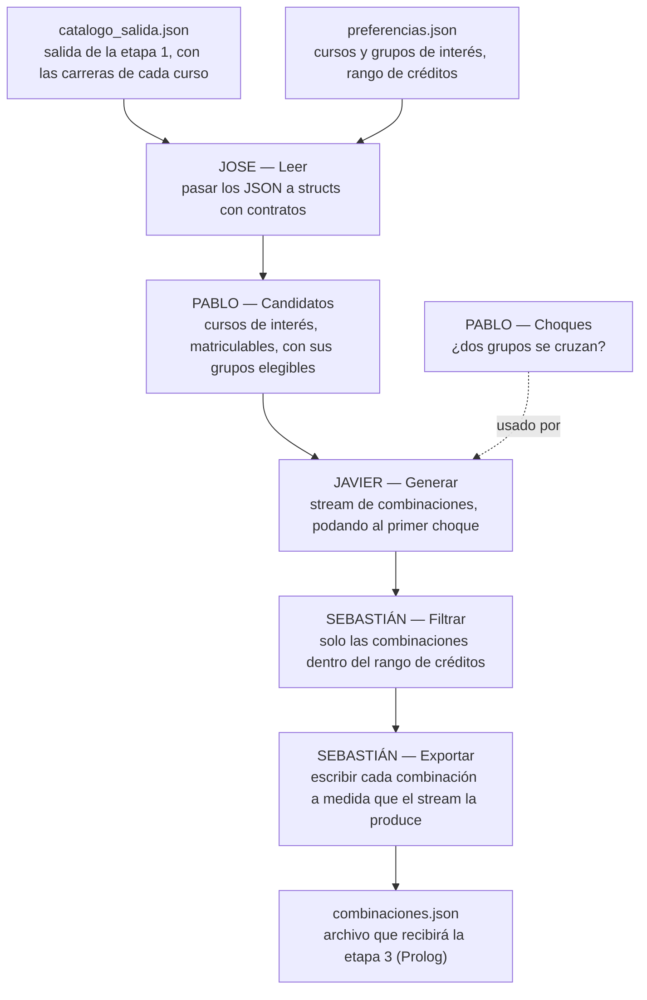

# CEmestre — Etapa 2 (Paradigma Funcional, Racket)

> Parte 2 de 4 del proyecto [CEmestre](../README.md). Lee lo que produjo
> [`etapa1-c/`](../etapa1-c/) y escribe lo que va a leer `etapa3-prolog/`.

Programa en Racket que, a partir del catálogo validado por la etapa 1 y de un
archivo de preferencias del estudiante, genera —con **streams**— todas las
combinaciones de horario sin choques, las filtra por el rango de créditos
deseado y las exporta a un archivo JSON que sirve de contrato para la
siguiente etapa (Prolog).

No arma el horario final, no sugiere ni optimiza, y no tiene interfaz: el
resultado es únicamente un archivo.

## Equipo

| Integrante | Módulo | Archivos |
|---|---|---|
| Jose | Tipos y lectura | `src/tipos.rkt`, `src/lectura.rkt` |
| Pablo | Choques y candidatos | `src/choques.rkt`, `src/candidatos.rkt` |
| Javier | Generación con streams y poda | `src/generacion.rkt` |
| Sebastián | Filtros (polimorfismo) y exportación | `src/filtros.rkt`, `src/exportacion.rkt` |

La distribución de tareas, el cronograma y el checklist de entregables están en
[distribucion-tareas-etapa2-cemestre.md](distribucion-tareas-etapa2-cemestre.md).

## Estado actual

Esta rama deja el **esqueleto**: structs con contratos, firmas de todas las
funciones públicas (con su contrato), `main.rkt` ya conectado, datos de
ejemplo y una suite de pruebas por módulo. La lógica de cada módulo está
pendiente (cada función lanza `error "TODO (nombre)"`); las pruebas de
`tests/` son la especificación y fallan hasta que se implementa cada módulo.

> El esqueleto compila (`make`) y todas las pruebas fallan únicamente con
> mensajes `TODO (nombre)`; ninguna falla por sintaxis o contratos.

## Cómo está organizado este documento

El enunciado pide un README con los puntos 2.1 a 2.3. Las secciones 1 a 4 de
abajo son el esqueleto de esos puntos: lo que ya está acordado está escrito, y
cada `TODO` marca lo que debe completar su responsable.

| Sección | Contenido | Punto del enunciado |
|---|---|---|
| 1. Arquitectura del proyecto | Flujo, estructura de archivos, entradas y salida | 2.1 |
| 2. Decisiones de diseño | Decisiones tomadas, caso límite, formato de salida | 2.2 |
| 3. Estructuras de datos | Structs y su razón de ser | 2.3 |
| 4. Módulos | Un apartado por integrante | 2.1 / 2.2.1 |
| 5. Compilar, ejecutar y probar | Comandos | — |
| 6. Flujo de trabajo del repositorio | Ramas y pull requests | Entregable 1 |

## 1. Arquitectura del proyecto

### 1.1 Flujo del programa

Esta etapa es un programa independiente: lee dos archivos JSON y escribe
uno. Entre ellos, los datos viajan como **streams**: cada paso consume el
stream del paso anterior y entrega otro, sin materializar nunca la lista de
combinaciones.



`main.rkt` encadena los módulos en ese orden.

### 1.2 Estructura de archivos

```
.
├── main.rkt                  # integración (tarea compartida) y punto de entrada
├── src/
│   ├── tipos.rkt             # structs inmutables + contratos (Jose)
│   ├── lectura.rkt           # JSON -> structs (Jose)
│   ├── choques.rkt           # ¿chocan dos grupos? (Pablo)
│   ├── candidatos.rkt        # catálogo + preferencias -> opciones (Pablo)
│   ├── generacion.rkt        # opciones -> stream de combinaciones, con poda (Javier)
│   ├── filtros.rkt           # filtros polimórficos y filtro de créditos (Sebastián)
│   └── exportacion.rkt       # stream de combinaciones -> JSON (Sebastián)
├── tests/                    # una suite rackunit por módulo + ejemplos.rkt compartido
├── data/
│   ├── catalogo_salida.json  # entrada: copia de la salida de la etapa 1
│   ├── preferencias.json     # entrada: ejemplo con más de un grupo por curso
│   ├── combinaciones.json    # salida (generada, no se versiona a mano)
│   └── data_doc.md           # esquema de los tres archivos
├── Makefile
└── distribucion-tareas-etapa2-cemestre.md
```

### 1.3 Entradas y salida

El esquema completo de cada archivo está en
**[`data/data_doc.md`](data/data_doc.md)**.

| Archivo | Rol |
|---|---|
| `data/catalogo_salida.json` | Entrada. Salida de la etapa 1 sin cambios de formato. Debe cubrir 6 semestres por carrera. |
| `data/preferencias.json` | Entrada. Cursos y grupos de interés (más de un grupo por curso) y créditos mínimo y máximo. |
| `data/combinaciones.json` | Salida. Una entrada por combinación: pares curso-grupo, créditos totales y carrera de cada curso. Contrato con la etapa 3. |

## 2. Decisiones de diseño

Regla del equipo: **se implementa lo que pide el enunciado y nada más.** Lo
único que se agrega fuera del enunciado es lo estrictamente necesario, y se
justifica aquí.

### 2.1 Decisiones ya tomadas

**Decisión 1 — Contratos en vez de Typed Racket.** El enunciado acepta
"Typed Racket o contratos". Se eligieron contratos (`#lang racket` con
`racket/contract`) porque Typed Racket no trae tipos para `racket/stream`
(ni para el macro `stream-cons`), y el requerimiento funcional 2 exige
streams. Con contratos, los structs se exportan con `contract-out` (cada campo
lleva su contrato), las funciones públicas llevan su contrato de entrada y
salida, y los streams se tipan con `stream/c`.

**Decisión 2 — Una combinación es un subconjunto de cursos.** Una combinación
es un subconjunto **no vacío** de los cursos candidatos, con un único grupo
por cada curso incluido y sin choques entre los grupos elegidos. Si cada
combinación llevara *todos* los cursos de interés, todas sumarían los mismos
créditos y el filtro por rango de créditos no tendría nada que filtrar. Si el
profesor indica otra interpretación, solo cambia `generacion.rkt`.

**Decisión 3 — Polimorfismo paramétrico con `parametric->/c`.** Las funciones
genéricas de `filtros.rkt` se exportan con `parametric->/c [A]`. A diferencia
de una función que solo "funciona con cualquier tipo", este contrato *hace
cumplir* el polimorfismo: si la función intentara inspeccionar un valor de
tipo `A`, el contrato lo detectaría.

**Decisión 4 — Choques recalculados por grupo, no heredados de C.** El
`choca_con_otro` de nuestra etapa 1 está **a nivel de curso** (es `true` si
*algún* grupo del curso choca con *algún* grupo de otro) y en el catálogo real
es `true` para todos los cursos del catálogo: no sirve para decidir qué grupos pueden ir
juntos. Como además no se debe modificar la lógica de choques de C,
`choques.rkt` compara bloque contra bloque los grupos concretos (mismas
reglas que la etapa 1: intervalo semiabierto `[inicio, fin)`, mismo día).

**Decisión 5 — Exportación incremental.** El archivo se escribe a medida que
el stream produce cada combinación; nunca se hace `stream->list`. Con miles de
combinaciones, la memoria usada es la de una sola.

**Decisión 6 — `seleccion` guarda los structs completos.** Una selección
guarda el `curso` y el `grupo` enteros, no solo `(codigo . numero)`. Así la
poda puede revisar los bloques de los grupos ya elegidos y la exportación
puede escribir créditos y carreras sin volver a buscar en el catálogo.

**Decisión 7 — La carrera por curso es el campo `carreras` de la etapa 1.** El
enunciado pide "cuál de las dos carreras lo aporta". La salida de C ya trae
`carreras`: una carrera para los cursos exclusivos y las dos para los
compartidos (ej. `MA1102`). Se usa tal cual, sin cambiar C, y se exporta como
`carreras` en cada selección. Si el profesor espera un único valor por curso,
habría que elegirlo en `lectura.rkt`.

**Decisión 8 — Solo se leen los campos que se usan.** `lectura.rkt` toma
`codigo`, `creditos`, `carreras`, `grupos` y `matriculable` del catálogo, y
ignora el resto. Menos código de lectura y menos structs que mantener.

**Decisión 9 — Grupos y cursos que no se pueden usar se ignoran sin aviso.**
Cursos de interés inexistentes o no matriculables, y grupos de interés que no
existen en el catálogo, se descartan. Un curso sin grupos elegibles no entra.
Los grupos de horario idéntico dentro de un mismo curso se conservan (son
grupos distintos para el estudiante).

**Decisión 10 — No se poda por créditos.** La poda que pide el enunciado es
por choques. El rango de créditos se aplica después, como filtro sobre el
stream (criterio de evaluación aparte).

> TODO (equipo): conforme se implemente, agregar aquí las decisiones propias
> de cada módulo con ejemplos reales del dataset (punto 2.2.1 del enunciado).

### 2.2 Caso límite real encontrado

> TODO (equipo, durante la implementación): documentar un caso límite real
> con datos del catálogo y cómo se resolvió. Candidatos que ya se ven desde
> el diseño:
>
> - `choca_con_otro` de la etapa 1 está en `true` para todos los cursos (a nivel
>   de curso), inútil para decidir combinaciones (decisión 4).
> - Cursos con grupos de horario idéntico (ej. `CE1106` grupos 1 y 3 tienen
>   los mismos bloques): generan combinaciones distintas con el mismo
>   horario.
> - Rango de créditos imposible (ninguna combinación): el archivo de salida
>   debe seguir siendo JSON válido.
> - Dos cursos de interés cuyos únicos grupos elegibles chocan entre sí: nunca
>   aparecen juntos en una combinación.

### 2.3 Justificación del formato de salida

> TODO (Sebastián): JSON, ligado a una decisión de diseño real. Argumento de
> partida: la salida se escribe de forma incremental desde un stream (decisión
> 5), y un único documento JSON con un arreglo `combinaciones` se puede
> producir así (inicio del arreglo, una combinación por vez, cierre), y lo lee
> Prolog directamente con `library(http/json)`.
>
> Campos extra (el enunciado pide justificarlos): `creditos` y `bloques` por
> selección, además de los tres mínimos. Esta etapa no se modifica después de
> entregarla y Prolog lee solo este archivo, así que `creditos` le permite
> sumar créditos por carrera (con solo el total y las carreras no podría) y
> `bloques` aplicar reglas de horario sin releer el catálogo. No se agregó
> ningún otro campo. Ver `data/data_doc.md`.

## 3. Estructuras de datos

Definidas en [`src/tipos.rkt`](src/tipos.rkt). Son el contrato contra el que
trabajan los cuatro módulos y están acordadas antes de repartir el trabajo,
igual que `estructuras.h` en la etapa 1. **Todas son inmutables.**

| Struct | Para qué existe |
|---|---|
| `bloque` | Una franja horaria. `dia` es un símbolo (`'L 'K 'M 'J 'V 'S`; `'K` es martes porque `'M` ya es miércoles, igual que en C); las horas son enteros `HHMM` para compararlas con `<` y `>` sin parsear. |
| `grupo` | Un grupo con uno o varios bloques (ej. martes y jueves). |
| `curso` | Un curso del catálogo: `codigo`, `creditos`, `carreras`, `grupos` y `matriculable` (calculado por la etapa 1). |
| `catalogo` | La lista de cursos leída del JSON. |
| `interes` / `preferencias` | Lo que pide el estudiante: cursos y grupos de interés, créditos mínimo y máximo. |
| `opcion` | Un curso candidato ya reducido a los grupos elegibles. Es la entrada de la generación. |
| `seleccion` | Un par curso-grupo elegido. |
| `combinacion` | Una lista de selecciones y sus créditos totales. Es el elemento de los streams. |

> TODO (equipo): cuando existan, describir aquí las estructuras auxiliares
> que cada módulo agregue (por ejemplo, el acumulador de la generación) y
> por qué.

## 4. Módulos

Cada responsable completa su apartado con: arquitectura del módulo,
decisiones de diseño con ejemplos reales del dataset y estructuras de datos
(formato de la sección 4 del README de la etapa 1).

### 4.1 Tipos y lectura — Jose

Archivos: `src/tipos.rkt`, `src/lectura.rkt`. Pruebas: `tests/test-lectura.rkt`.

> TODO (Jose)

### 4.2 Choques y candidatos — Pablo

Archivos: `src/choques.rkt`, `src/candidatos.rkt`. Pruebas:
`tests/test-choques.rkt`, `tests/test-candidatos.rkt`.

> TODO (Pablo)

### 4.3 Generación con streams y poda — Javier

Archivo: `src/generacion.rkt`. Pruebas: `tests/test-generacion.rkt`.

**Qué hace.** Recibe la lista de `opcion` de `candidatos.rkt` y devuelve un
`(stream/c combinacion?)` con todas las combinaciones sin choques (decisión 2:
subconjuntos no vacíos, un grupo por curso incluido).

| Función | Contrato | Descripción |
|---|---|---|
| `generar-combinaciones` | `(-> (listof opcion?) (stream/c combinacion?))` | Punto de entrada. Arranca la recursión con los acumuladores vacíos. |
| `armar-combinacion` | `(-> (listof seleccion?) combinacion?)` | Suma los créditos con `foldl` y construye la `combinacion`. |
| `descender` (privada) | opciones, elegidas, grupos-elegidos → stream | Recursión principal: por cada curso, la rama "no tomarlo" seguida de la rama "tomarlo con cada grupo". |
| `tomar-con-cada-grupo` (privada) | curso, grupos, … → stream | Una rama por grupo del curso. **Aquí está la poda.** |
| `anexar-perezoso` (privada) | `(stream A)` × `(-> (stream A))` → `(stream A)` | Concatena dos streams sin construir el segundo hasta que el primero se agota. |

**Algoritmo.** Es un recorrido en profundidad de un árbol de decisiones: en
cada nivel se decide sobre un curso (no tomarlo, o tomarlo con alguno de sus
grupos). Con el mini-catálogo de `tests/ejemplos.rkt` (A1 choca con B1):

```
                     (inicio)
         ___________/   |   \___________
     sin A            A1               A2
    /  |  \        /  |   \         /  |  \
 sinB  B1  B2   sinB B1(X) B2    sinB  B1  B2
```

Cada hoja con al menos un curso elegido es una combinación. El resultado son
las 15 combinaciones que calcula a mano `ejemplos.rkt`.

**Poda (criterio de grupos de 4).** Antes de bajar a la rama "tomar el curso
con el grupo g", `tomar-con-cada-grupo` revisa
`(compatible-con-seleccion? g grupos-elegidos)` (de `choques.rkt`). Si g choca
con algo ya elegido, la rama se salta en ese mismo nivel: en el ejemplo, en
`(X)` se corta todo lo que colgaría de A1+B1 (A1+B1 y A1+B1+C), sin
construirlo. No se genera ninguna combinación completa para luego
descartarla.

**Streams y pereza.**
- Cada elemento se entrega con `stream-cons`, cuyo resto no se evalúa hasta
  que alguien lo pide.
- La segunda rama de cada decisión viaja como *thunk* (`(lambda () ...)`) y
  `anexar-perezoso` solo la llama cuando la primera se agotó. No se usa
  `stream-append` porque es una función: Racket evaluaría las dos ramas antes
  de llamarla.
- Pedir la primera combinación solo recorre un camino del árbol. La prueba de
  pereza (20 cursos × 3 grupos, unas 4²⁰ ≈ 10¹² combinaciones) toma 50 al
  instante.

**Diseño funcional.** No hay `set!` ni estructuras mutables. El estado de la
búsqueda (lo elegido hasta el momento) viaja como argumentos de la recursión,
y cada rama recibe su propia lista construida con `cons`. Las demás ramas
nunca ven esa lista, así que no hace falta "deshacer" una elección al
retroceder, como sí haría falta con un arreglo mutable en C.

**Estructuras auxiliares (acumuladores de la recursión).**
- `elegidas` (`(listof seleccion)`): las selecciones de la rama actual, en
  orden **inverso**. `cons` agrega al frente en O(1), y la lista se invierte
  una sola vez al armar la combinación, así que las selecciones salen en el
  mismo orden que la lista de interés.
- `grupos-elegidos` (`(listof grupo)`): los mismos grupos de `elegidas`, ya
  separados. Es lo que recibe `compatible-con-seleccion?`. Llevarlo como
  acumulador evita recalcular `(map seleccion-grupo elegidas)` cada vez que se
  revisa un grupo.

**Orden de salida.** Primero salen las combinaciones que *no* incluyen el
primer curso de interés, y al final las que lo incluyen con su último grupo.
El orden no tiene significado: la etapa 3 decide cuál conviene.

### 4.4 Filtros y exportación — Sebastián

**Archivos:** `src/filtros.rkt`, `src/exportacion.rkt`.
**Pruebas:** `tests/test-filtros.rkt`, `tests/test-exportacion.rkt`
y `tests/test-filtros_exportacion.rkt`.

Se filtran las combinaciones mediante streams por un rango inclusivo de
créditos. Los filtros son reutilizables y `por-rango` utiliza un contrato
paramétrico, sin mutación de datos.

La exportación escribe progresivamente un JSON con cursos, grupos,
carreras, créditos y bloques horarios para su uso en Prolog. Si no hay
resultados, exporta una lista vacía.

**Validación:** 56 pruebas aprobadas y 60 combinaciones exportadas con
los datos y preferencias actuales.

> TODO (Sebastián)

## 5. Compilar, ejecutar y probar

Requiere [Racket](https://racket-lang.org) (con `racket` y `raco` en el PATH)
y `make`.

> **Windows:** igual que en la etapa 1, correr `make` desde **Git Bash**.

```bash
make            # compila los módulos (raco make)
make run        # compila y ejecuta con las rutas por defecto
make test       # corre las suites de tests/
make exe        # genera bin/cemestre-racket (el ejecutable de la revisión)
make clean      # borra compiled/ y bin/
```

Rutas por defecto (ver `main.rkt`): `data/catalogo_salida.json`,
`data/preferencias.json`, `data/combinaciones.json`. También se pueden pasar
como argumentos:

```bash
racket main.rkt data/catalogo_salida.json data/preferencias.json data/combinaciones.json
```

Para probar un solo módulo:

```bash
raco test tests/test-choques.rkt
```

## 6. Flujo de trabajo del repositorio

Igual que en la etapa 1:

- `main` recibe únicamente los merges de `develop` ya verificados (compila y
  las pruebas pasan).
- `develop` es la rama de integración.
- Cada quien trabaja en su rama de feature a partir de `develop` y la integra
  mediante pull request conforme pasa sus pruebas:

  | Integrante | Rama |
  |---|---|
  | Jose | `feature/tipos-lectura` |
  | Pablo | `feature/choques-candidatos` |
  | Javier | `feature/generacion-streams` |
  | Sebastián | `feature/filtros-exportacion` |

- Los datos de los semestres 5 y 6 van en ramas propias sobre `etapa1-c/` y se
  integran a `develop` antes de regenerar el catálogo.
- `main.rkt` se completa en conjunto, en `develop`, una vez que cada módulo
  pasa sus pruebas.
- Cuando la etapa está completa y verificada en `develop`, se hace merge a
  `main` como entrega final: **último commit antes del viernes 30 de octubre
  de 2026, 9:30 a.m.**
