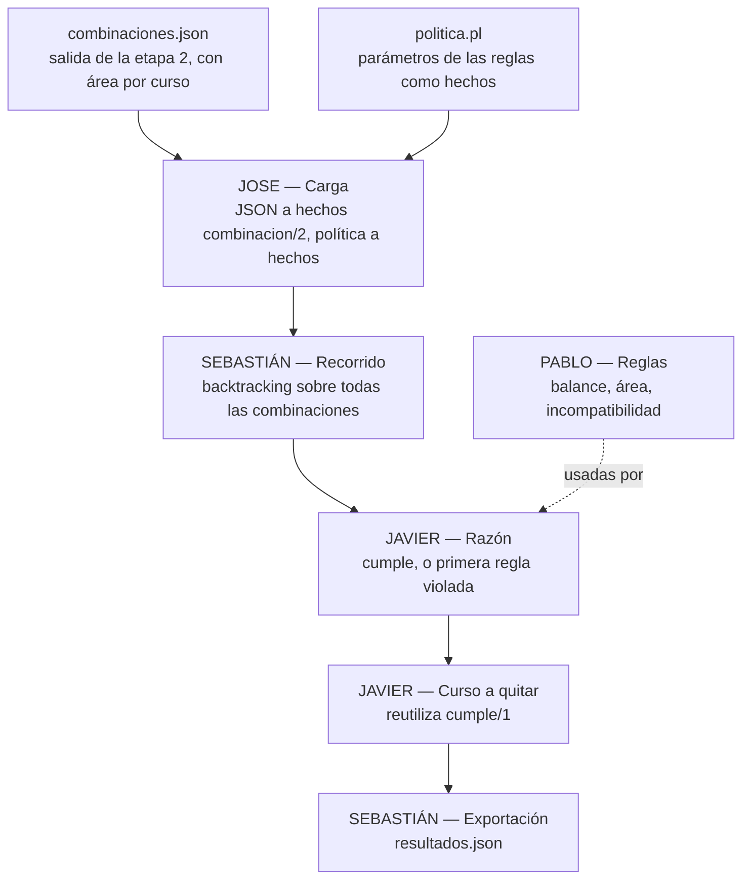

# CEmestre — Etapa 3 (Paradigma Lógico, Prolog)

> Parte 3 de 4 del proyecto [CEmestre](../README.md). Lee lo que produjo
> [`etapa2-racket/`](../etapa2-racket/) y escribe lo que va a leer `etapa4-java/`.

Programa en Prolog que evalúa cada combinación de horario generada por la
etapa 2 contra tres reglas de política académica (balance entre carreras,
límite por área e incompatibilidad) y exporta, por combinación, si cumple y,
si no, **la primera regla que viola**. Por ser grupo de 4, también calcula
qué curso podría quitarse de una combinación rechazada para que cumpla.

No genera combinaciones, no vuelve a filtrar por créditos y no tiene interfaz:
el resultado es únicamente un archivo.

## Equipo

| Integrante | Módulo | Archivos |
|---|---|---|
| Jose | Modelo y carga; extensión de C y Racket (área, 8 semestres) | `src/modelo.pl`, `src/carga.pl` |
| Pablo | Reglas de política | `src/reglas.pl` |
| Javier | Razón de rechazo y curso a quitar | `src/razon.pl`, `src/sugerencia.pl` |
| Sebastián | Recorrido, exportación y política | `src/evaluacion.pl`, `src/exportacion.pl`, `data/politica.pl` |

La distribución de tareas, la extensión de las etapas 1 y 2, el cronograma y el
checklist de entregables están en
[distribucion-tareas-etapa3-cemestre.md](distribucion-tareas-etapa3-cemestre.md).

## Estado actual

Esta rama deja el **esqueleto**: términos del modelo, firmas de todos los
predicados públicos, `main.pl` ya conectado, el archivo de política, un
ejemplo de combinaciones escrito a mano y una suite de pruebas por módulo. La
lógica de cada módulo está pendiente (cada predicado lanza un error
`pendiente(Nombre, Responsable)` que `main.pl` muestra como "falta
implementar"); las pruebas de `tests/` son la especificación y fallan hasta
que se implementa cada módulo.

> El esqueleto se probó con SWI-Prolog 10.0.2: `make` carga todos los módulos
> sin errores y `make test` solo falla por los `pendiente(...)` de lo que falta
> implementar. Los resultados esperados de `tests/ejemplos.pl` se validaron
> con una implementación de referencia (descartada), y los ejemplos de la
> sección 2.3 son lo que **deben** devolver los predicados una vez
> implementados.
>
> En SWI-Prolog 10 `make run` imprime el aviso `Library was moved:
> library(http/json) --> library(json)`. Es inofensivo y se deja porque
> `library(http/json)` también existe en las versiones 9.x.

## Cómo está organizado este documento

El enunciado pide un README con los puntos 2.1 a 2.3. Lo ya acordado está
escrito, y cada `TODO` marca lo que debe completar su responsable.

| Sección | Contenido | Punto del enunciado |
|---|---|---|
| 1. Arquitectura del proyecto | Flujo, estructura de archivos, entradas y salida | 2.1 |
| 2. Decisiones de diseño | Decisiones tomadas, orden de reglas, caso límite, formato de salida | 2.2 |
| 3. Representación de datos y predicados | Términos, predicados principales y consultas en más de un modo | 2.3 |
| 4. Compilar, ejecutar y probar | Comandos | — |
| 5. Flujo de trabajo del repositorio | Ramas y pull requests | Entregable 1 |

## 1. Arquitectura del proyecto

### 1.1 Flujo del programa

Esta etapa es un programa independiente: lee las combinaciones de Racket y un
archivo de política, y escribe un resultado. Las combinaciones quedan como
hechos y se recorren **por backtracking**.



`main.pl` encadena los módulos:

```prolog
ejecutar(RutaCombinaciones, RutaPolitica, RutaSalida) :-
    cargar_politica(RutaPolitica),
    cargar_combinaciones(RutaCombinaciones),
    evaluar_todas(Resultados),
    exportar_resultados(RutaSalida, Resultados).
```

### 1.2 Estructura de archivos

```
.
├── main.pl                   # punto de entrada: encadena los módulos
├── src/
│   ├── modelo.pl             # términos y accesores (Jose)
│   ├── carga.pl              # JSON y política -> hechos (Jose)
│   ├── reglas.pl             # las tres reglas de política (Pablo)
│   ├── razon.pl              # primera regla violada, cumple/1 (Javier)
│   ├── sugerencia.pl         # curso a quitar, grupos de 4 (Javier)
│   ├── evaluacion.pl         # recorrido por backtracking (Sebastián)
│   └── exportacion.pl        # resultados -> JSON (Sebastián)
├── tests/                    # una suite plunit por módulo + ejemplos.pl compartido
├── data/
│   ├── combinaciones.json    # entrada: salida de la etapa 2
│   ├── politica.pl           # entrada: parámetros como hechos
│   ├── resultados.json       # salida (generada)
│   └── data_doc.md           # esquema de los archivos
├── Makefile
└── distribucion-tareas-etapa3-cemestre.md
```

### 1.3 Entradas y salida

El esquema completo está en **[`data/data_doc.md`](data/data_doc.md)**.

| Archivo | Rol |
|---|---|
| `data/combinaciones.json` | Entrada. Salida de la etapa 2 más el campo `area` por curso. Cubre 8 semestres por carrera. |
| `data/politica.pl` | Entrada. Porcentaje máximo por carrera, máximo de cursos por área, pares incompatibles y orden de las reglas, como hechos. |
| `data/resultados.json` | Salida. Por combinación: pares curso-grupo, `cumple`, `razon` y `cursos_a_quitar`. Contrato con la etapa 4 (Java). |

## 2. Decisiones de diseño

Regla del equipo: **se implementa lo que pide el enunciado y nada más.** Lo
único que se agrega fuera del enunciado es lo estrictamente necesario, y se
justifica aquí.

### 2.1 Decisiones ya tomadas

**Decisión 1 — Cómo se modelan las combinaciones.** Cada combinación es un
hecho `combinacion(Id, Cursos)`, y `Cursos` es una lista de términos
`curso(Codigo, Grupo, Creditos, Carreras, Area)`. `Id` es la posición de la
combinación en el archivo de Racket, para que Java pueda cruzar el resultado
con esa combinación. Los hechos se crean con `assertz` **solo al cargar el
archivo de entrada**, que es lo que permite el enunciado; todo lo demás
trabaja con argumentos y unificación. Las reglas reciben la lista `Cursos`,
no el `Id`, así que se pueden probar sin cargar nada.

**Decisión 2 — Cómo se asigna el área.** Por **disciplina del contenido del
curso**, con 6 áreas fijas: `matematica`, `fisica_quimica`, `computacion`,
`electronica`, `industrial` y `humanidades`. Casi siempre coincide con el
prefijo del código (`MA`, `FI`, `EL`, `PI`, `CI`...) y se documentan las
excepciones. El área se agrega en C como un campo del curso y Racket solo lo
propaga. Criterio completo y tabla de prefijos en
[`distribucion-tareas-etapa3-cemestre.md`](distribucion-tareas-etapa3-cemestre.md),
sección 4.1. Ejemplos reales: `MA1102` Cálculo es `matematica`; `QU1107` Química
Básica II y `FI2103` Física General III son `fisica_quimica` (dos de los tres
cursos que hacen violar el límite en la combinación `e_orden` de
`tests/ejemplos.pl`); `PI2610` Probabilidad y Estadística I es `matematica`
aunque su prefijo sea de Producción Industrial.

En los semestres 7 y 8 pasa lo mismo. `CE1111` Análisis Numérico para la
Ingeniería es `matematica` y no `computacion`, igual que `CM3207` Métodos
Numéricos; `CE1112` Taller de Señales Mixtas es `electronica`, como `CE1110`;
`AE4208` Desarrollo de Emprendedores tiene un prefijo que no está en ninguna
área, y se asignó a `industrial` porque es gestión, como `PI3501` Costos
Industriales I; `CS4402` Seminario de Estudios Costarricenses es
`humanidades`. Los 85 cursos del catálogo quedan repartidos en 22 de
`industrial`, 19 de `computacion`, 15 de `humanidades`, 11 de `matematica`,
10 de `fisica_quimica` y 8 de `electronica`.

**Decisión 3 — Reparto de créditos de un curso compartido.** Un curso de las
dos carreras reparte sus créditos **en partes iguales** entre ellas para la
regla 1. Así los porcentajes de las carreras suman 100 % de los créditos
totales, y una combinación solo de cursos compartidos queda 50 % / 50 %. Si un
curso compartido contara completo para cada carrera, las dos carreras llegarían
a 100 % y la regla se violaría siempre que hubiera cursos compartidos. El
cálculo usa racionales (`rdiv`) y se compara con multiplicaciones
(`CreditosCarrera * 100 > Maximo * Total`), sin floats.

**Decisión 4 — Pares incompatibles.** La política declara cuatro pares (el
enunciado pide al menos dos), todos entre cursos del catálogo actual que se
traslapan en contenido:

| Par | Por qué |
|---|---|
| `PI2609` / `PI2610` | Probabilidad y Estadística del plan de Computadores y del de Producción Industrial: mismo contenido, distinto código. |
| `CI1407` / `CI1106` | Habilidades de Comunicación en Ingeniería (Computadores) y Comunicación Escrita (Producción): los dos son el curso de comunicación de su plan. |
| `SE1400` / `SE1100` | La actividad cultural-deportiva sustituye a la actividad cultural. |
| `PI5516` / `PI3501` | Ingeniería Económica y Costos Industriales I: análisis de costos en ambos. |

TODO (Sebastián): validar los pares contra el catálogo de 8 semestres y
ajustar la justificación o agregar pares.

**Decisión 5 — La política son hechos y el orden de las reglas también.** Los
parámetros (porcentaje por carrera, máximo por área, pares) y el orden de
revisión (`orden_reglas/1`) están en `data/politica.pl`. Ninguna regla tiene un
número o un par escrito: en la defensa se pueden cambiar los valores sin tocar
el código.

**Decisión 6 — La razón de rechazo es la primera regla violada del orden de
la política.** `primera_violacion/3` recibe el orden como argumento y se queda
con la primera regla violada usando **corte**; `cumple/1` es **negación por
falla** de `primera_violacion`. Ver 2.2.1 para el caso donde el orden cambia la
razón.

```prolog
primera_violacion([R0|_], Cursos, Regla) :-
    viola(R0, Cursos),
    !,
    Regla = R0.
primera_violacion([_|Resto], Cursos, Regla) :-
    primera_violacion(Resto, Cursos, Regla).

cumple(Cursos) :-
    \+ primera_violacion(Cursos, _).
```

*Por qué el corte.* El enunciado pide **una** razón por combinación: la
primera regla violada. Sin el corte, al pedir más soluciones por backtracking
`primera_violacion` seguiría con la segunda cláusula y devolvería también las
reglas siguientes que se violan. Con `e_orden`, que viola el balance y el área,
daría `R = balance_carreras ; R = limite_area`: la "primera" violación tendría
dos respuestas y cuál se exporta dependería de quién la consume. Además,
`viola/2` puede tener éxito varias veces para la misma regla (por ejemplo,
`viola_area` recorre la lista y tiene éxito una vez por cada posición donde un
área pasa el límite), así que sin el corte la misma razón también podría
repetirse. El corte, puesto justo después de `viola(R0, Cursos)`, descarta
las dos cosas: las reglas siguientes y las demás formas de demostrar la misma
regla. El predicado queda determinista.

*Por qué la salida se unifica después del corte.* Si la cabeza fuera
`primera_violacion([R|_], Cursos, R)`, una consulta con la regla ya dada se
saltaría las reglas anteriores cuando no unifican con la cabeza. Con `e_orden`
y el orden de la política:

```prolog
?- primera_violacion([balance_carreras, limite_area, incompatibilidad], Cursos, limite_area).
false.   % con la salida después del corte (correcto: la primera es balance_carreras)
true.    % si se unificara en la cabeza (incorrecto)
```

Por eso primero se toma la regla de la lista (`R0`), se corta y solo después
se compara con `Regla`. `evaluar/2` sigue el mismo patrón: con una regla
violada corta y devuelve `viola(Regla)`; sin el corte, al hacer backtracking
caería en su segunda cláusula y la misma combinación saldría también como
`cumple`.

*Por qué negación por falla.* Prolog no demuestra directamente que algo *no*
pasa; `\+ Meta` tiene éxito cuando `Meta` no se puede demostrar. Una
combinación cumple justamente cuando no se puede demostrar ninguna violación,
así que `cumple/1` es `\+ primera_violacion(Cursos, _)` y las reglas se
escriben una sola vez, en positivo (`viola/2`). La alternativa sería escribir
cada regla otra vez al revés (`cumple_balance`, `cumple_area`,
`cumple_incompatibilidad`): la lógica quedaría en dos lugares, que pueden
contradecirse si en la defensa se cambia una regla y no la otra. Es seguro
porque `cumple/1` siempre se llama con `Cursos` ya conocido y solo verifica: no
necesita dejar ninguna variable ligada, y la `_` de la razón queda dentro de la
negación.

**Decisión 7 — Curso a quitar (grupos de 4).** `cursos_a_quitar/2` devuelve
**todos** los cursos que, quitados de uno en uno, dejan la combinación
cumpliendo todas las reglas. Reutiliza `cumple/1`: no hay lógica de reglas
duplicada. Una combinación que quedaría vacía no cuenta. Si ningún curso solo
la arregla, la lista es vacía.

```prolog
cursos_a_quitar(Cursos, Codigos) :-
    cumple(Cursos),
    !,
    Codigos = [].
cursos_a_quitar(Cursos, Codigos) :-
    findall(Codigo,
            ( select(Curso, Cursos, Resto),
              Resto \== [],
              cumple(Resto),
              curso_codigo(Curso, Codigo) ),
            Codigos).
```

- **Se devuelven todos, no uno.** El enunciado pide "qué curso podría
  quitarse"; cuando hay varias opciones válidas, dárselas todas a Java le
  permite mostrarlas sin que esta etapa elija por el estudiante.
- **Primera cláusula.** Si la combinación ya cumple no hay nada que sugerir.
  Sin esta cláusula, una combinación válida devolvería los cursos cuya salida
  la deja cumpliendo igual, y eso no es una sugerencia. Igual que en
  `razon.pl`, el corte evita la segunda cláusula y `Codigos` se unifica
  después del corte.
- **Segunda cláusula.** `select/3` saca un curso a la vez por backtracking, en
  el orden de la combinación, y deja los demás en `Resto`; `cumple/1` valida lo
  que queda y `findall/3` junta los códigos que sirven (da `[]` si ninguno
  sirve). Los códigos salen en el mismo orden que los cursos de la combinación.
- **Combinación vacía.** Quitar el único curso deja una lista vacía, que no es
  un horario: `Resto \== []` la descarta.

Resultados con los ejemplos de `tests/ejemplos.pl` y la política de
`data/politica.pl`:

| Combinación | Razón | `cursos_a_quitar` | Por qué |
|---|---|---|---|
| `a_cumple` | — | `[]` | Ya cumple (primera cláusula). |
| `b_balance` | `balance_carreras` | `[]` | Los tres cursos son solo de Producción Industrial: quitando cualquiera sigue al 100 %. |
| `c_area` | `limite_area` | `['FI1201']` | Sin `FI1201` quedan 2 cursos de `fisica_quimica` y Computadores en 66,7 %. Sin `QU1106` o sin `FI1101` Computadores sube a 71,4 %, y sin `CE1106` siguen 3 de `fisica_quimica`. |
| `d_incompatibilidad` | `incompatibilidad` | `['CI1407', 'CI1106']` | Quitando cualquiera de los dos se rompe el par y cada carrera queda en 66,7 % / 33,3 %; quitando `MA1102` el par sigue. |
| `e_orden` | `balance_carreras` | `[]` | Quitando cualquiera sigue siendo solo de Producción Industrial. |

**Decisión 8 — Los pares curso-grupo salen de las selecciones de Racket.**
Esta etapa no genera ni modifica combinaciones: evalúa exactamente las que
recibe, en el mismo orden.

**Decisión 9 — Un solo ejecutable de línea de comandos.** `swipl main.pl`
corre el pipeline completo (`initialization(main, main)`). Los argumentos
opcionales son las rutas de combinaciones, política y salida.

### 2.2 Decisiones propias y específicas

#### 2.2.1 Modelado, área, pares incompatibles y orden de las reglas

Los tres primeros puntos están en las decisiones 1 a 4. Falta el caso donde el
orden de las reglas cambia la razón reportada.

**Caso del orden de reglas.** La combinación `e_orden` (`tests/ejemplos.pl`,
también la quinta de `tests/combinaciones_ejemplo.json`) tiene tres cursos solo de
Producción Industrial y de `fisica_quimica`: `QU1107` grupo 1, `FI2103` grupo 1
y `QU1104` grupo 1. Viola dos reglas a la vez: los tres cursos son de una sola
carrera (100 % > 70 %, `balance_carreras`) y son 3 cursos de la misma área
(3 > 2, `limite_area`). Con `orden_reglas([balance_carreras, limite_area,
incompatibilidad])` la razón es `balance_carreras`; con
`orden_reglas([limite_area, balance_carreras, incompatibilidad])` es
`limite_area`.

```prolog
?- primera_violacion([balance_carreras, limite_area, incompatibilidad], Cursos, R).
R = balance_carreras.
?- primera_violacion([limite_area, balance_carreras, incompatibilidad], Cursos, R).
R = limite_area.
```

TODO (Pablo y Javier): verificar la consulta con la implementación real y
elegir en el orden por defecto la regla más grave primero (hoy es el balance
entre carreras).

#### 2.2.2 Caso límite real

TODO (en conjunto, con los datos reales de 8 semestres). Candidato: **un curso
compartido entre las dos carreras** y cómo se reparten sus créditos (decisión
3). En la combinación `c_area` (`CE1106` + `QU1106` + `FI1101` + `FI1201`) las
tres de `fisica_quimica` son compartidas: repartidas en partes iguales dejan a
Computadores en 65 % (cumple el balance) y a Producción en 35 %; si cada
compartido contara completo para las dos carreras, Computadores quedaría en
100 % y la regla se violaría sin que la combinación esté desbalanceada. Otro
candidato: la combinación que solo se arregla quitando dos cursos (la lista
`cursos_a_quitar` queda vacía). Confirmar con el catálogo real cuál se
documenta.

#### 2.2.3 Justificación del formato de salida

TODO (Sebastián). El formato es **JSON**, igual que las etapas 1 y 2: un
documento con un arreglo `combinaciones`, un objeto por combinación (ejemplo en
[`data/data_doc.md`](data/data_doc.md)). Justificar ligándolo a una decisión
real: la etapa 4 (Java) lee exactamente este archivo, y con JSON conserva la
estructura anidada (`selecciones` como arreglo de objetos `curso`/`grupo`) y
representa la ausencia de razón con `null`.

**Campos del enunciado.** `selecciones` (pares curso-grupo), `cumple` y
`razon`.

**Campos agregados y su justificación.**

- `id`: posición de la combinación en el archivo de Racket. Java puede cruzar
  el resultado con esa combinación para mostrar bloques y créditos, sin que
  esta etapa los repita.
- `cursos_a_quitar`: lo exige el criterio de grupos de 4 (calcular qué curso se
  puede quitar); sin exportarlo, el cálculo no se vería.

No se agregó ningún otro campo.

## 3. Representación de datos y predicados principales

### 3.1 Términos

Están en [`src/modelo.pl`](src/modelo.pl).

| Término | Forma | Para qué existe |
|---|---|---|
| `curso` | `curso(Codigo, Grupo, Creditos, Carreras, Area)` | Un par curso-grupo de una combinación. `Carreras` es una lista porque un curso puede ser de las dos carreras. |
| `combinacion` | `combinacion(Id, Cursos)` | Una combinación de Racket. Es un hecho dinámico: solo la carga lo crea. |
| `resultado` | `resultado(Id, Cursos, Cumple, Razon, CursosAQuitar)` | El veredicto de una combinación. Lo produce `evaluacion.pl` y lo consume `exportacion.pl`. |

Hechos de política (en `data/politica.pl`): `max_porcentaje_carrera/2`,
`max_cursos_area/1`, `par_incompatible/2` y `orden_reglas/1`.

### 3.2 Predicados principales

| Módulo | Predicado | Qué hace |
|---|---|---|
| `carga.pl` | `cargar_politica(+Ruta)`, `cargar_combinaciones(+Ruta)` | Dejan la política y las combinaciones como hechos. |
| `reglas.pl` | `viola_balance/1`, `viola_area/1`, `viola_incompatibilidad/1`, `viola(?Regla, +Cursos)` | Tienen éxito cuando la combinación viola la regla. |
| `reglas.pl` | `creditos_carrera(+Cursos, ?Carrera, ?Creditos)`, `incompatibles(?A, ?B)` | Predicados usables en más de un modo. |
| `razon.pl` | `primera_violacion(+Orden, +Cursos, -Regla)`, `primera_violacion/2`, `cumple/1`, `evaluar/2` | Razón de rechazo. |
| `sugerencia.pl` | `cursos_a_quitar(+Cursos, -Codigos)` | Cursos que, quitados de uno en uno, arreglan la combinación. |
| `evaluacion.pl` | `evaluar_combinacion/2`, `evaluar_todas/1` | Recorre todas las combinaciones por backtracking. |
| `exportacion.pl` | `exportar_resultados(+Ruta, +Resultados)` | Escribe el JSON de salida. |

### 3.3 Consultas en más de un modo

TODO (Pablo): verificar y completar con la implementación real. Con
`data/politica.pl` cargada, `incompatibles/2` se usa en cuatro modos:

```prolog
?- incompatibles('CI1407', 'CI1106').       % verificar un par
true.
?- incompatibles('CI1106', X).              % los incompatibles de un curso
X = 'CI1407'.
?- incompatibles(X, 'CI1407').              % la relación es simétrica
X = 'CI1106'.
?- incompatibles(A, B).                     % enumerar todos los pares (8 con ambos sentidos)
A = 'PI2609', B = 'PI2610' ;
...
```

`creditos_carrera/3` también sirve en dos modos: con la carrera dada calcula sus
créditos, y sin ella enumera cada carrera de la combinación con los suyos.

### 3.4 Carga de los datos

Está en [`src/carga.pl`](src/carga.pl) y es el único módulo que ve JSON crudo
y el único que usa `assertz`, porque solo carga datos de entrada.

- `cargar_politica(+Ruta)` consulta `data/politica.pl` en el módulo `user`, así
  que los hechos de política los ven todos los módulos.
- `cargar_combinaciones(+Ruta)` lee el JSON de Racket en UTF-8 con
  `json_read_dict/2`. Primero convierte **todas** las combinaciones y solo
  después borra las anteriores y guarda las nuevas, para no dejar la carga a
  medias si una viene mal. Cada combinación queda como `combinacion(Id, Cursos)`
  con `Id` igual a su posición en el archivo (desde 1).
- De cada selección solo se usan `curso`, `grupo`, `creditos`, `carreras` y
  `area`; `bloques` y `creditos_totales` se ignoran.
- Los strings del JSON pasan a átomos con `atom_string/2`, tanto el código del
  curso como el área y cada carrera. Así `'CE1106'` y
  `'Ingeniería en Computadores'` son los mismos átomos que usan los hechos de
  `data/politica.pl` y la unificación funciona sin conversiones.
- Los errores dicen qué pasó: archivo inexistente (`source_sink ... does not
  exist`), JSON mal formado o vacío (error de sintaxis de JSON) y campo
  faltante (`campo 'area' does not exist`).

```prolog
?- cargar_combinaciones('data/combinaciones.json'), combinacion(1, Cursos).
Cursos = [curso('MI2101', 1, 3, ['Ingeniería en Producción Industrial'], industrial),
          curso('QU1107', 2, 3, ['Ingeniería en Producción Industrial'], fisica_quimica),
          curso('FI2103', 2, 3, ['Ingeniería en Producción Industrial'], fisica_quimica)].
```

Con los datos del repositorio se cargan 60 combinaciones.

## 4. Compilar, ejecutar y probar

Requiere [SWI-Prolog](https://www.swi-prolog.org) con `swipl` en el PATH y
`make` (en Windows, desde Git Bash). Correr desde esta carpeta.

```bash
make          # carga los módulos sin ejecutar nada (revisa la sintaxis)
make run      # ejecuta con los archivos de data/
make test     # corre las pruebas de tests/ (plunit)
```

También se pueden indicar los archivos:

```bash
swipl main.pl data/combinaciones.json data/politica.pl data/resultados.json
```

## 5. Flujo de trabajo del repositorio

Una rama por integrante o por tarea (`feature/...`), commits pequeños y
significativos, y pull request hacia `develop`; `main` solo recibe `develop`
cuando todo compila y `make test` pasa. Commits de los 4 integrantes a lo largo
de la etapa.
